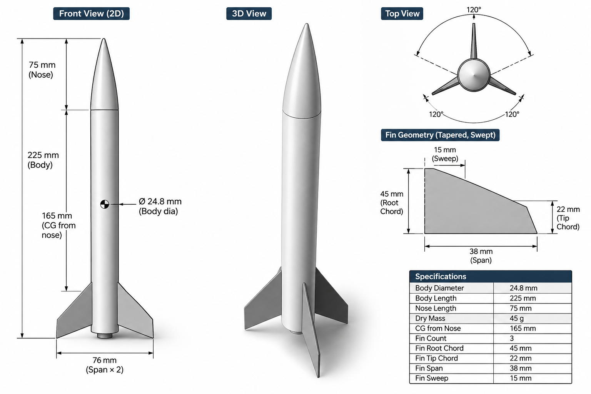
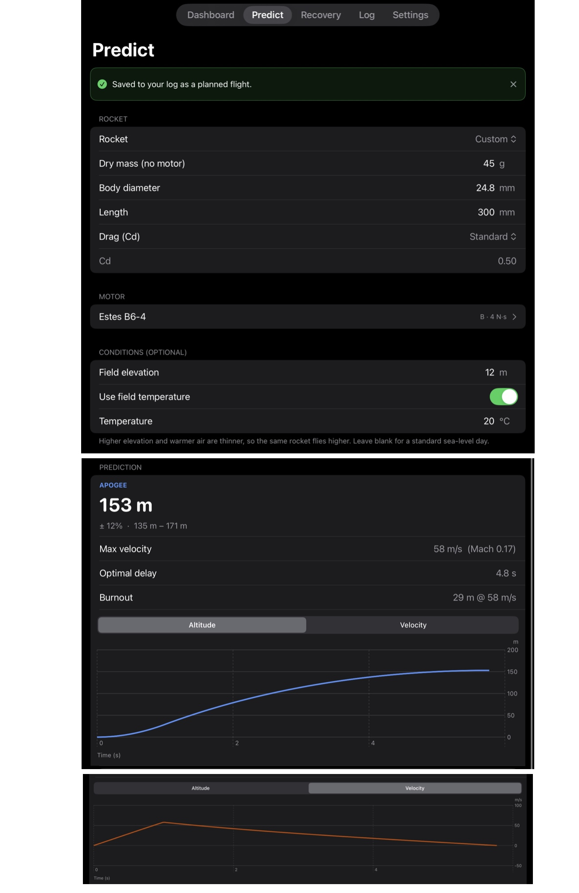
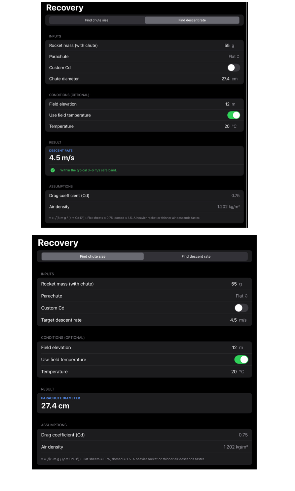

# aerolog-24.8
Sub-25 mm model rocket airframe with an onboard flight-data logger (from barometer, accelerometer, etc.) built to test OpenRocket aerodynamic predictions against real-world flight curves.

## What This Project Is
Online simulators like OpenRocket predict rocket performance under ideal conditions (153 m apogee, 58 m/s max velocity, Cd = 0.50). To understand how real-world factors like wind and atmospheric drag affect flight, I am building a physical 24.8 mm test airframe equipped with compact onboard measurement sensors (altimeter/accelerometer) to record actual flight data and compare it directly against my simulated curves.

## Current Progress
* Completed preliminary engineering drawings and fin geometry calculations (24.8 mm body diameter, 300 mm total length, 165 mm CG).
* Modeled trajectory and recovery parameters in simulation software (27.4 cm flat parachute for a 4.5 m/s descent rate).
* Next phase: Sourcing materials and onboard measurement electronics to construct and test the physical prototype under adult technical supervision.
## Engineering Drawings & Simulations

### Airframe & Fin Geometry

### Flight Trajectory Prediction

### Parachute Recovery Calculation

